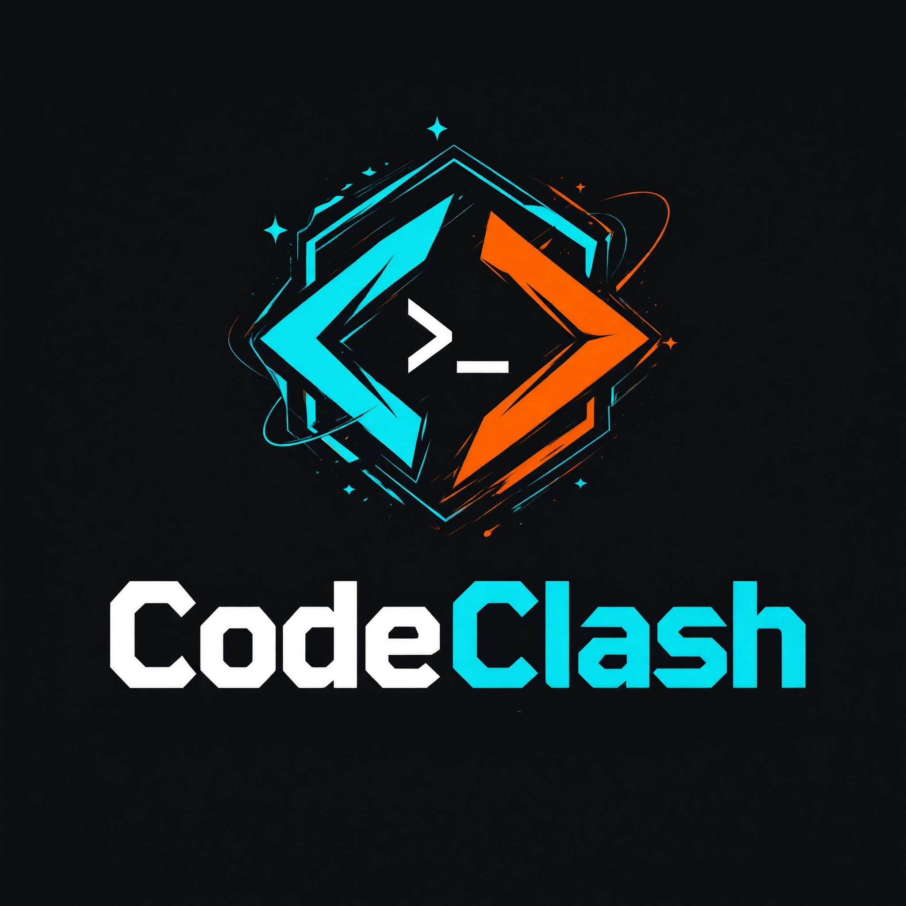
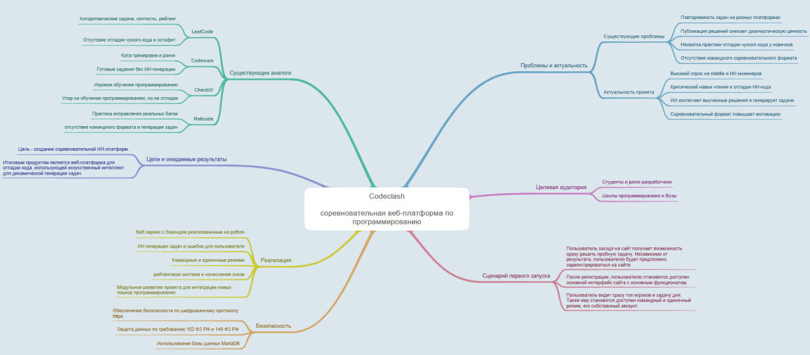
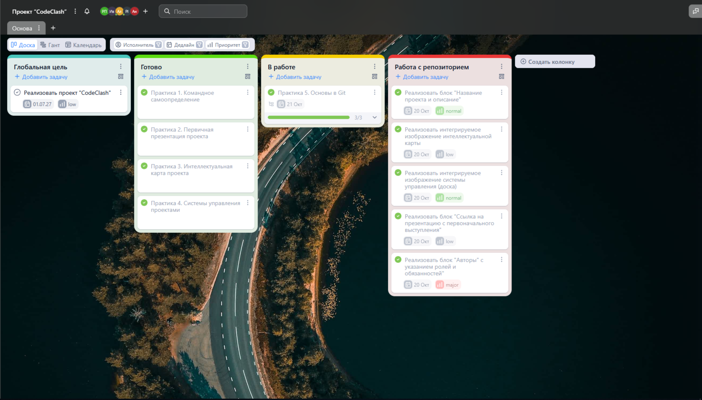

# CodeClash 
## Соревновательная веб-платформа по программированию.

## Описание
### Проблема
• Популярные платформы (LeetCode, Codewars, Codeforces) основаны на заранее подготовленном банке задач: часть заданий повторяется, решения массово публикуются в сети и снижают диагностическую ценность тренировки.

• Начинающим разработчикам не хватает практики отладки чужого кода — ключевого навыка в реальной работе.

• Командная разработка ничем не тренируется: нет формата соревнований, имитирующего передачу кода между разработчиками.

### Актуальность
• Рынок труда в ИТ поляризован: спрос на middle/senior-разработчиков и инженеров, работающих с ИИ, сохраняется высоким, а умение читать и отлаживать чужой (в т.ч. ИИ-сгенерированный) код становится критическим навыком.

• ИИ позволяет генерировать большое количество вариантов задач и снижает риск «выученных» решений.

• Соревновательный формат повышает мотивацию и вовлечённость учащихся.

### Существующие аналоги

#### LeetCode / Codeforces
Алгоритмические задачи, рейтинг, регулярные контесты.
Нет формата отладки чужого кода и командной эстафеты.

#### Codewars / HackerRank
Ката-тренировки, ранги; на HackerRank есть отдельные debugging-задачи.
Готовые задания, нет AI-генерации под каждый матч и эстафеты

#### CheckiO / CodeCombat
Игровое обучение программированию (Python, TypeScript и др.)
Упор на обучение, а не на соревнование и передачу кода между участниками

#### Recticode и подобные
Практика исправления реальных багов.
Нет соревновательного командного формата и генерации задач ИИ.

### Область применения и потенциальный потребитель

#### Студенты и junior-разработчики
Практика отладки и скорость чтения кода, рейтинг и мотивация.

#### Школы программирования и вузы
Готовый инструмент для практических занятий и олимпиад, автоматическая проверка без затрат на составление задач.

#### IT-компании и рекрутеры
Оценка кандидатов в формате реальной командной разработки, корпоративные турниры для обучения сотрудников.

#### Модель коммерциализации:
подписка для образовательных организаций и компаний (B2B/B2C), корпоративные лицензии, платные турниры и кастомные контесты.

## Конечный продукт: CodeClash

#### Что создаётся
Веб-платформа (Python-бэкенд + веб-интерфейс), в которой ИИ генерирует код с закладками-ошибками и задачи по программированию.

#### Основные функции:
• батлы 1×1 и командные: участник чинит функцию и передаёт её имя напарнику — чем больше команда, тем сложнее цепочка зависимостей;

• соло-режим: ИИ генерирует задачу, решение на скорость и минимум строк;

• рейтинговая система и начисление очков за эффективность самого кода и его оптимальность .

### Конкурентные преимущества
• ИИ снижает повторяемость заданий и повышает их разнообразие.

• Эстафетный командный режим — главное коркуретное отличие продукта.

• Двойная метрика: эффективность самого кода и его оптимальность.

• Пошаговое модульное масштабирование: на старте — один язык (Python), далее JavaScript, C++ и другие.

## Интеллектуальная карта
Построена с помощью [IOctopus](https://mind-map-online.ru/sh-fffaa9fd709a1174)

## Система управления
Для регулировки обязанностей каждого из членов команды, а аткже задач в целом была реализована [система управления](https://ru.yougile.com/team/a250feac30cf/CodeClash#COD-16)

## Выступления
* [первичная презентация](presentations/CodeClash.pdf)
* ...

## Авторы

|ФИО|Роль|Обязанности|
|:-:|:-:|:-|
|Поздеев Роман|Разведчик/Оценщик|хто мы|
|Жигалко Роман|Коллективист/Председатель|хто мы|
|Денисов Иван|Коллективист/Председатель|хто мы|
|Сандлер Алексей|Разведчик/Коллективист|хто мы|
|Дмитриев Никита|Доводчик/Коллективист|хто мы|
|Сарычев Антон|Оценщик/Доводчик|хто мы|
|~~Коваленко Максим~~|Разведчик/Оценщик|был SWOON из команды самим собой|
